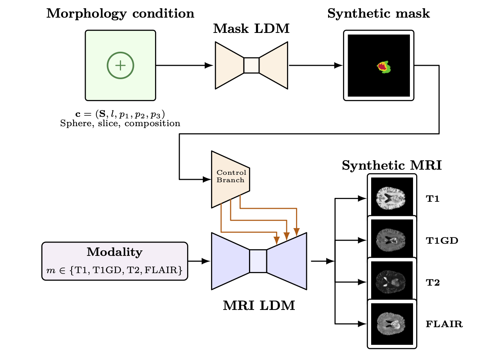
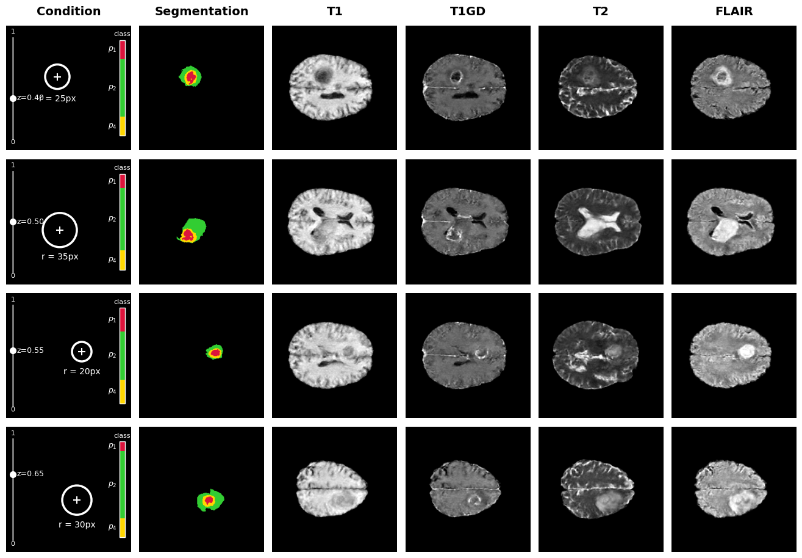

# Controllable Brain MRI Synthesis with Conditional Latent Diffusion Models

This repository contains the implementation of a two-stage conditional latent diffusion framework for **controllable synthetic glioblastoma brain MRI generation**, developed as part of an MSc research project at Stellenbosch University in collaboration with Stanford University.

The framework enables explicit control over tumour location, size, and subregion composition, and generates corresponding synthetic MRI scans across four modalities: **T1, T1Gd, T2, and FLAIR**.

## Framework

The framework consists of two stages:

1. **Segmentation Latent Diffusion Model (Seg-LDM):** Generates synthetic tumour segmentation maps conditioned on a specified tumour centroid, radius, and subregion proportions, using classifier-free guidance.
2. **MRI Latent Diffusion Model (MRI-LDM):** A modality-conditioned diffusion backbone augmented with ControlNet generates anatomically plausible MRI slices corresponding to the supplied tumour segmentation map.

By chaining these models, the framework enables the generation of fully synthetic, paired MRI images and tumour annotations with controllable pathology.

## Examples

*Examples of generated tumour segmentation maps and corresponding synthetic MRI scans.*

## Datasets

Training and evaluation use two publicly available datasets from The Cancer Imaging Archive (TCIA):

- [UPenn-GBM](https://www.cancerimagingarchive.net/collection/upenn-gbm/) — University of Pennsylvania Glioblastoma.
- [UCSF-PDGM](https://www.cancerimagingarchive.net/collection/ucsf-pdgm/) — UCSF Preoperative Diffuse Glioma MRI.

Both datasets provide multimodal brain MRI scans and corresponding tumour segmentation annotations. Images are processed as two-dimensional axial slices at a resolution of 256 × 256.

## Implementation

The implementation is developed in **PyTorch** and includes:

- Variational autoencoders for MRI and segmentation latent representations.
- Conditional diffusion U-Nets with classifier-free guidance.
- ControlNet for segmentation-conditioned MRI synthesis.
- Data preprocessing, training, sampling, and evaluation pipelines.
- YAML configurations for reproducible experiments.

## Evaluation

The framework is evaluated through:

- **Conditional adherence:** Tumour centroid, radius, and class-composition errors.
- **Image fidelity:** Modality-specific and pooled Fréchet Inception Distance (FID).
- **Qualitative analysis:** Controlled generation experiments and an expert reader study.

## Licence

See [LICENSE](LICENSE) for licensing information.

**Disclaimer:** Generated MRI scans are intended for research purposes and have not been validated for clinical use.
